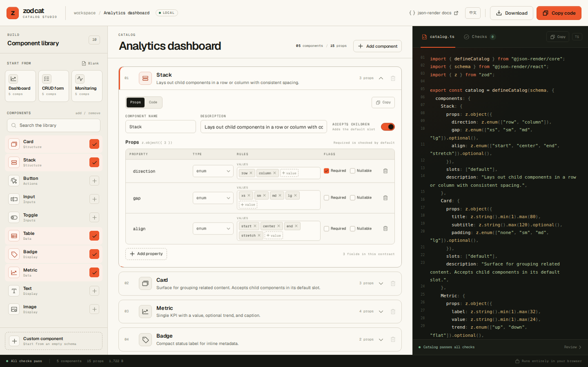
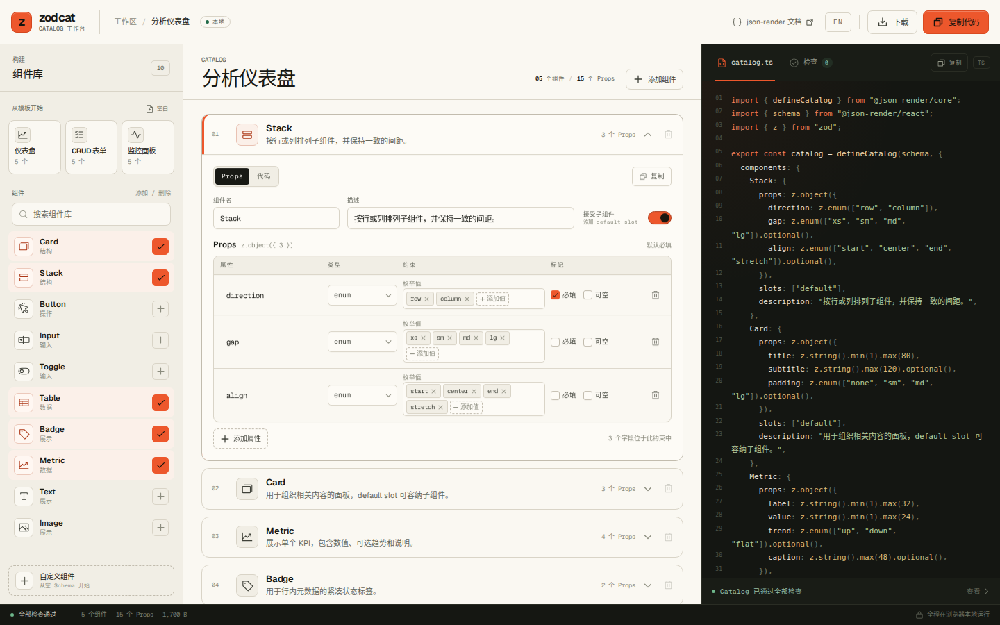

# zodcat

[](https://github.com/Jianwen-Xu/zodcat/actions/workflows/ci.yml)
[](https://github.com/Jianwen-Xu/zodcat/actions/workflows/pages.yml)
[](LICENSE)

[Open the live demo](https://jianwen-xu.github.io/zodcat/)

**A visual catalog definer for [json-render](https://json-render.dev).** Configure components, shape their Zod schemas, and copy a production-ready `defineCatalog` file. No backend, no account, no hand-written boilerplate.



A json-render catalog is the guardrail for AI-generated UI. It is also tedious to write: every component needs a precise Zod schema, a description, and the right slots. zodcat turns that into a visual editing loop while enforcing the conventions that keep catalogs useful.

## Before and after

A hand-written first pass often starts loose, then gets patched after prompt testing:

```ts
Card: {
  props: z.object({
    title: z.string(),
    padding: z.any(),
  }),
  description: "Card",
},
```

With zodcat, the shape and the guardrails are part of the editing flow:

```ts
Card: {
  props: z.object({
    title: z.string().min(1).max(80),
    padding: z.enum(["none", "sm", "md", "lg"]).optional(),
  }),
  slots: ["default"],
  description: "Surface for grouping related content. Accepts child components in its default slot.",
},
```

The second version gives the model a bounded target and gives your renderer a truthful type. That is the whole product.

## Languages

The interface ships in English and Chinese. Use the language button in the header to switch. The choice is saved locally, and first visits follow the browser language. Starter catalog names and built-in component descriptions follow the active language, while text you edit yourself is left untouched. Component identifiers and generated TypeScript syntax stay as code.



## What it does

- **Start from a template** or an empty catalog.
- **Add components** from a focused library: Card, Stack, Button, Input, Toggle, Table, Badge, Metric, Text, and Image.
- **Define props** with string, number, boolean, enum, or an explicitly flagged escape hatch.
- **Constrain the contract** with length bounds, numeric ranges, enum values, optional and nullable modifiers.
- **Describe components** so the model knows when to pick them, and opt into the default children slot.
- **Inspect one component at a time** with the Props / Code switch, then copy that component fragment on its own.
- **Copy in one click** from the top bar or the code header, or download a real `catalog.ts` with `defineCatalog(schema, { components })`. If the browser blocks clipboard access, a selected-code fallback dialog opens automatically.
- **Switch between English and Chinese** from the header. The choice persists locally, and checks, templates, toasts, library copy, starter catalog names, and built-in descriptions follow the active language.
- **Catch weak schemas early** with live checks for unconstrained props, `z.any()`, `z.unknown()`, empty enums, duplicate keys, invalid bounds, and oversized catalogs.
- **Undo destructive moves** from a toast, and keep your draft in local storage automatically.

## Run locally

Requires Node.js 20.19 or newer.

```bash
git clone https://github.com/Jianwen-Xu/zodcat.git
cd zodcat
npm install
npm run dev
```

Open the URL printed by Vite. Everything runs in the browser.

```bash
npm test       # unit tests for codegen and validation
npm run build  # type-check and production build
```

## The output

The generated file follows the schema-first json-render API:

```ts
import { defineCatalog } from "@json-render/core";
import { schema } from "@json-render/react";
import { z } from "zod";

export const catalog = defineCatalog(schema, {
  components: {
    Card: {
      props: z.object({
        title: z.string().min(1).max(80),
        subtitle: z.string().max(120).optional(),
        padding: z.enum(["none", "sm", "md", "lg"]).optional(),
      }),
      slots: ["default"],
      description: "Surface for grouping related content. Accepts child components in its default slot.",
    },
  },
});
```

Copy or download it into your app's `catalog.ts`. zodcat does not add a runtime dependency to your project.

### Schema import

The generated code imports `schema` from `@json-render/react`, which is the documented platform schema. If your app uses a custom schema, change that one import after copying. The component contract itself stays valid.

## Guardrails

The live audit is the opinionated part of the tool. It flags:

| Rule | Behavior |
| --- | --- |
| No escape hatches | Warns on `z.any()` and `z.unknown()` |
| Bounded props | Warns on strings and numbers without an explicit limit |
| Focused catalog | Warns past eight components and suggests splitting by surface |
| Valid shape | Errors on duplicate names, empty enums, invalid bounds, and inverted ranges |

Warnings do not block copying. The catalog is yours, but the output shows exactly where the contract gets loose.

## Design decisions

- **Form, not canvas.** This tool defines constraints, not layout. A form is faster to operate and easier to learn.
- **TypeScript, not JSON.** Developers ultimately need something they can paste into `catalog.ts`.
- **Schema-first.** The internal representation is serialized to `defineCatalog(schema, ...)` rather than inventing a competing format.
- **Browser only.** Code generation, validation, clipboard, and local persistence all happen client-side. There is no server to trust.
- **One accent, two surfaces.** The light drafting surface is for designing; the dark output surface is for reading the contract.

## Project structure

```text
src/
  components/      UI: header, library, catalog editor, code panel, checks, toast
  data/            component library and starter catalogs
  lib/
    codegen.ts     JSON intermediate representation -> defineCatalog code
    validation.ts  guardrail rules
    storage.ts     local persistence, clipboard, downloads
  types.ts         internal catalog representation
```

The catalog state lives in a small JSON model: component metadata plus a list of typed props and constraints. Both code generation and validation are pure functions over that model, which keeps them easy to test.

## Scope and roadmap

zodcat is a focused authoring tool, not a full application generator. It owns the contract between an AI-generated UI and a real renderer.

### Included today

- Visual component and prop editing.
- Typed constraints, enums, optional and nullable modifiers.
- Default slots, descriptions, live code, templates, autosave, and guardrails.
- English and Chinese UI.

### Next: schema coverage

- Action declarations and component event bindings.
- Named slots.
- Array and object props.
- Import an existing `catalog.ts`.

### Next: Registry scaffold

Generate a typed `registry.tsx` next to `catalog.ts`:

- A `defineRegistry(catalog, { components })` map for the current component set.
- Minimal, accessible implementations for the built-in library.
- Typed placeholders for custom components, with explicit TODOs.
- Separate copy and download for `registry.tsx`.
- Optional `@json-render/shadcn` preset later.

This closes the gap between [Quick Start step 1](https://json-render.dev/docs/quick-start) and [step 2](https://json-render.dev/docs/quick-start#2-define-your-components). It also provides the renderer needed for previewing a catalog.

Registry scaffolding should generate a safe, replaceable skeleton. It should not pretend to replace a user's design system or generate business components.

### Later: AI preview

- Natural language prompt to spec, then validate and render with the generated registry.
- The preview must validate against the same catalog and registry; otherwise it proves nothing.

## Compatibility

Built against the catalog API and documentation for json-render `0.21.x`: `defineCatalog(schema, catalog)` with `components`, `props`, `slots`, and `description`. json-render is evolving; if the API changes, the translation layer lives in [`src/lib/codegen.ts`](src/lib/codegen.ts).

zodcat is an independent community companion, not an official json-render package.

## Contributing

Issues and pull requests are welcome. Read [CONTRIBUTING.md](CONTRIBUTING.md) for setup, architecture notes, and the review checklist. Please use the issue forms for bugs and feature requests.

## Security

zodcat has no backend and does not upload catalog content. For vulnerability reports, follow [SECURITY.md](SECURITY.md).

## License

MIT. See [LICENSE](LICENSE).
